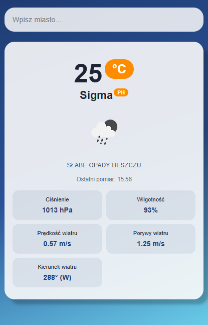
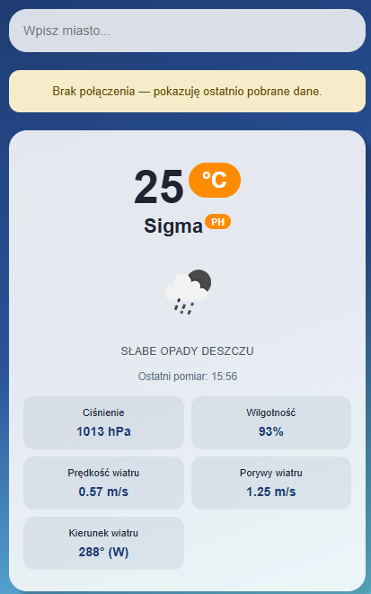
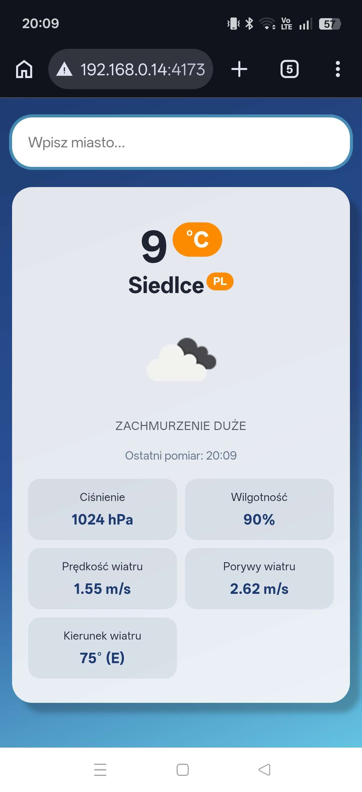

# lab_03 – Aplikacja pogodowa

Aplikacja pogodowa korzystająca z API OpenWeatherMap. Wyświetla dane pogodowe dla wybranego miasta i obsługuje tryb offline.

## Uruchomienie

```bash
npm install
npm run build
npm run preview
```

## Zrzuty ekranu

### PC – tryb online


### PC – tryb offline


### Telefon
