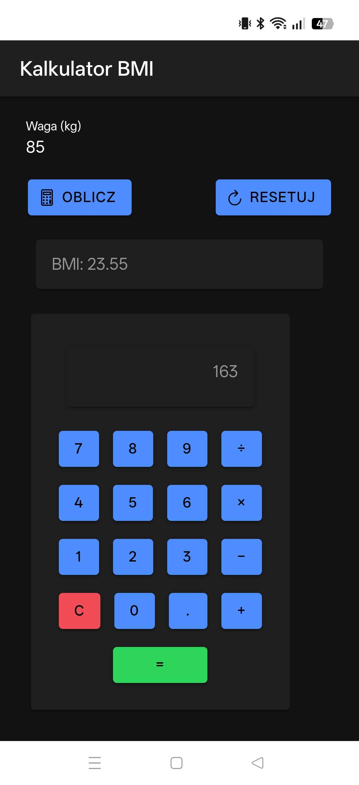
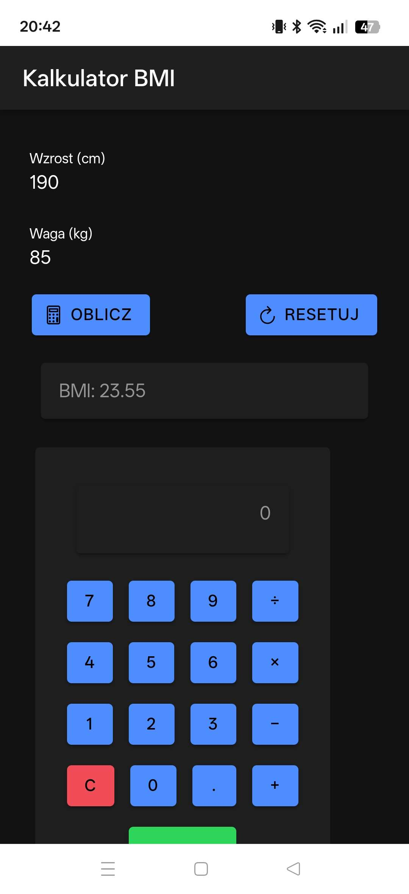

# lab_04 – Pierwsza aplikacja w Ionic React

Link do aplikaci: https://lab04-bonda.web.app/

## Uruchomienie

1. Sklonuj repozytorium:
   ```bash
   git clone https://github.com/jb88608/aplikacje-mobilne.git
   ```
2. Przejdź do folderu projektu:
   ```bash
   cd lab_04
   ```
3. Zainstaluj zależności:
   ```bash
   npm install
   ```
4. Uruchom aplikację:
   ```bash
   ionic serve
   ```
## Zrzuty ekranu

### Kalkulator BMI z wynikiem (w widoku telefonu)


### Kalkulator z zadania trzeciego z wynikiem (w widoku telefonu)
