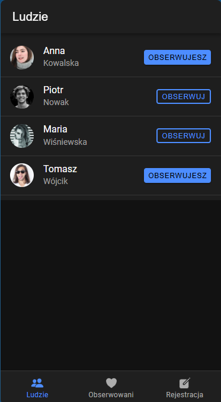
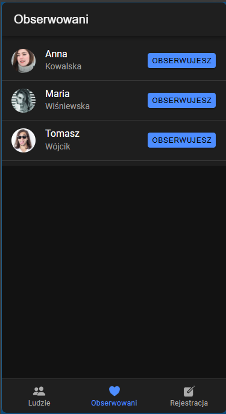
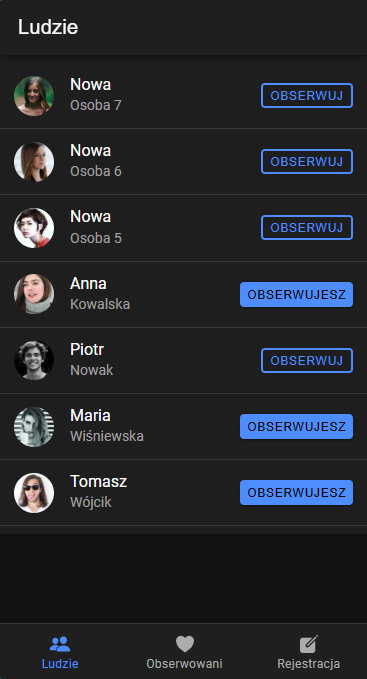
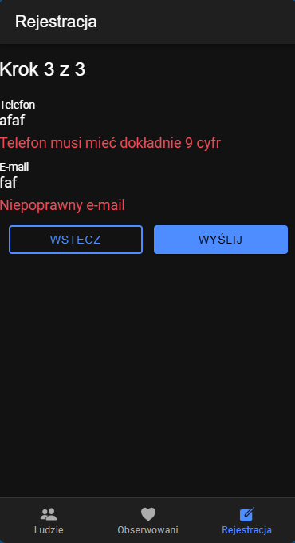
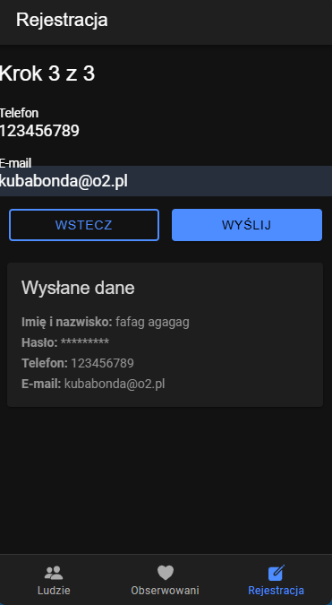

# Lab 06

## Uruchomienie aplikacji

1. Przejdź do folderu projektu.
2. Zainstaluj zależności:

   ```bash
   npm install
   ```

3. Uruchom aplikację:

   ```bash
   ionic serve
   ```

## Zrzuty ekranu

### 1. Lista osób


### 2. Lista obserwowanych


### 3. Szczegóły osoby


### 4. Lista po odświeżeniu – nowa osoba


### 5. Formularz – komunikat błędu


### 6. Formularz – wysłane dane

